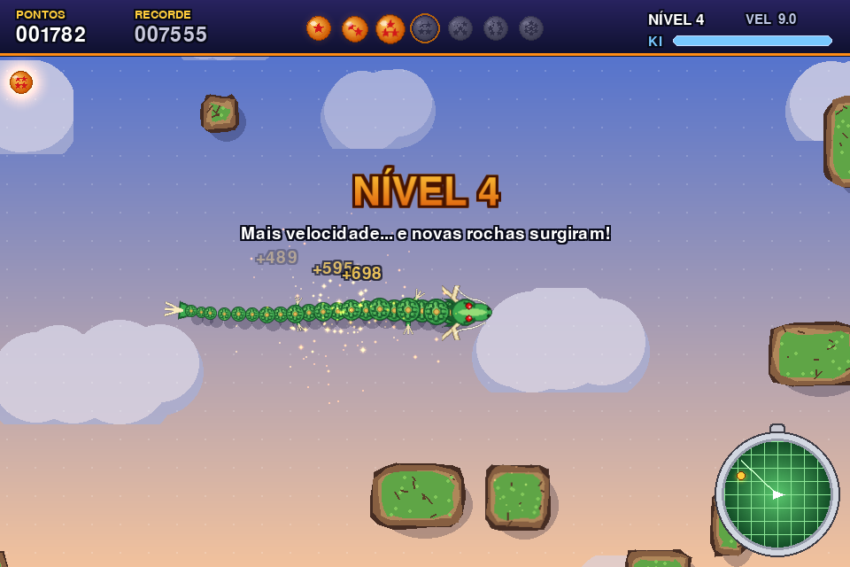
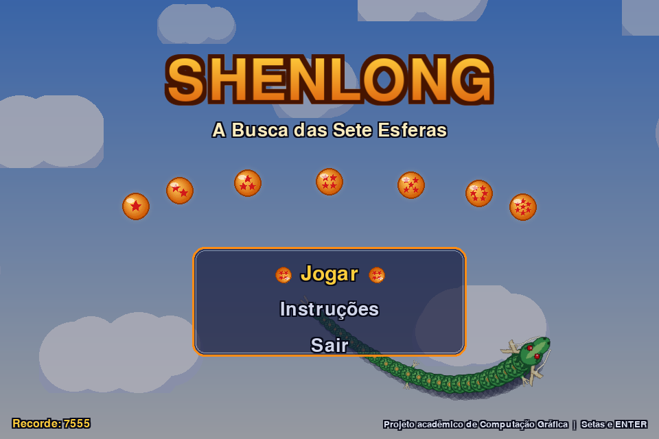
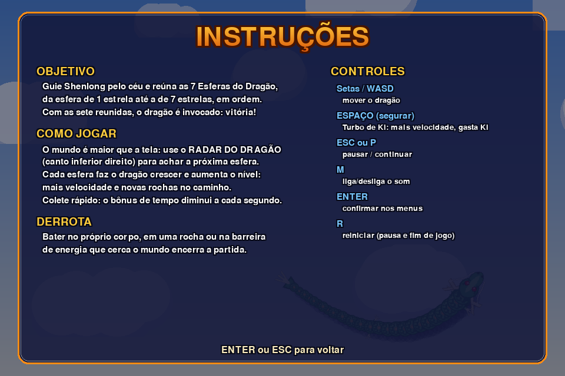
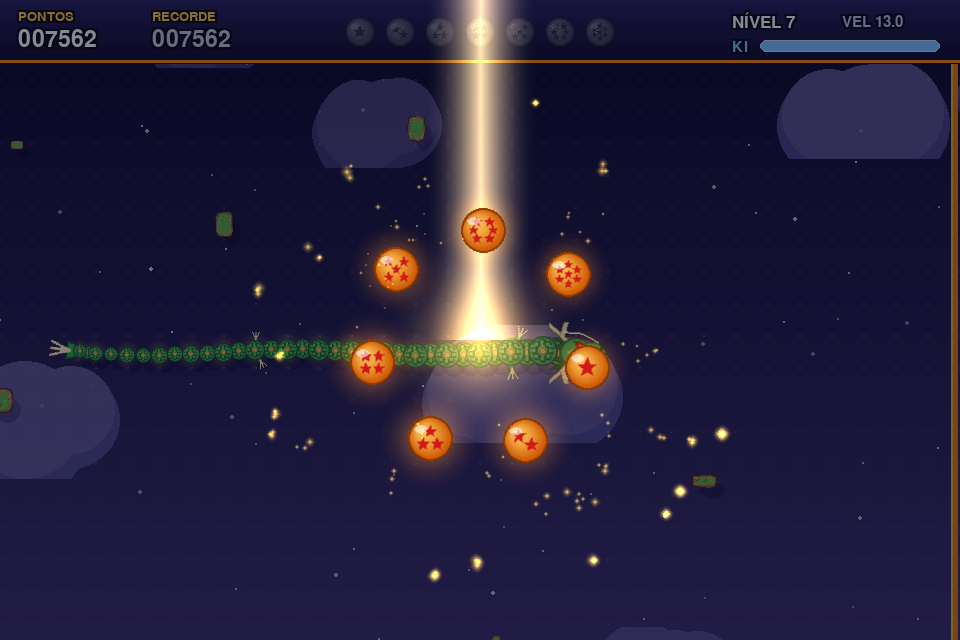
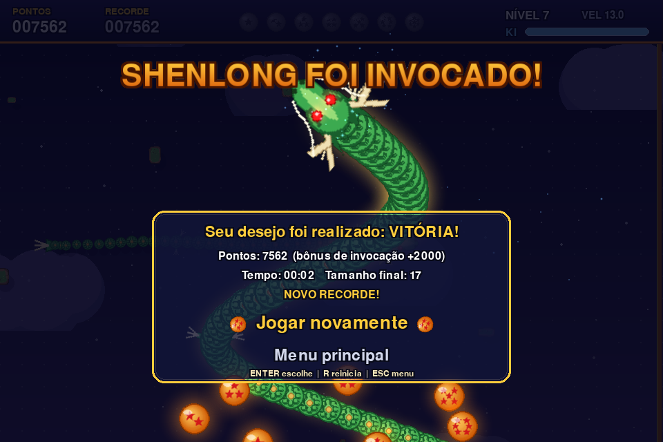
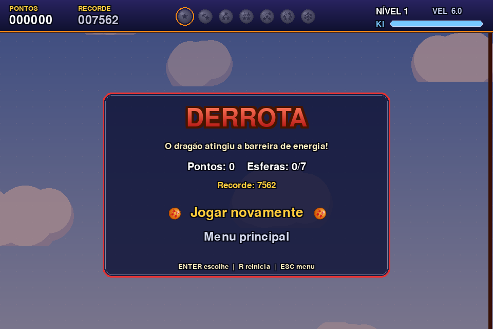

# Shenlong: A Busca das Sete Esferas

Projeto avaliativo da disciplina de **Computação Gráfica**, em **Python 3 + Pygame**.

Uma releitura do clássico "jogo da cobrinha" ambientada no universo de *Dragon Ball*: o
jogador controla um dragão inspirado em **Shenlong**, voa por um céu maior que a tela,
encontra as Esferas do Dragão com o **Radar do Dragão** e, ao reunir as sete, invoca o
dragão em uma cinemática de encerramento.



---

## Sumário

1. [Descrição](#descrição)
2. [Requisitos](#requisitos)
3. [Instalação](#instalação)
4. [Execução](#execução)
5. [Controles](#controles)
6. [Regras](#regras)
7. [Estrutura do projeto](#estrutura-do-projeto)
8. [Técnicas de Computação Gráfica](#técnicas-de-computação-gráfica)
9. [Decisões técnicas](#decisões-técnicas)
10. [Testes](#testes)
11. [Créditos](#créditos)
12. [Uso de IA](#uso-de-ia)
13. [Limitações conhecidas](#limitações-conhecidas)

---

## Descrição

### Conceito
O jogador é o dragão Shenlong. As sete Esferas do Dragão estão espalhadas por um céu
amplo, cheio de rochedos flutuantes. Cada esfera coletada faz o dragão crescer e torna a
jornada mais difícil. Quando as sete são reunidas, o céu escurece e Shenlong é invocado.

### Objetivo
Coletar as 7 esferas, **em ordem** (1 estrela → 7 estrelas), sem colidir.

### Mecânicas
- Movimento contínuo em grade, com curvas de 90° e fila de comandos.
- Crescimento de 3 segmentos por esfera.
- Mundo de 44 × 30 células (1408 × 960 px), maior que a área visível: a câmera segue o dragão.
- **Radar do Dragão** no HUD indicando a direção da próxima esfera.
- **Turbo de Ki**: segurar ESPAÇO aumenta a velocidade em 60%, consumindo a barra de Ki.
- **Bônus de tempo**: quanto mais rápido a esfera for coletada, mais pontos.
- **Progressão por nível**: cada esfera aumenta a velocidade e faz surgir novas rochas.
- O céu muda de **dia → tarde → pôr do sol → noite** conforme as esferas são reunidas.

### O que diferencia do Snake tradicional
| Snake tradicional | Shenlong: A Busca das Sete Esferas |
|---|---|
| Tela única, tudo visível | Mundo maior que a tela, câmera e **radar** para navegação |
| Comida idêntica e infinita | **7 esferas distintas**, coletadas em ordem, com fim definido |
| Velocidade fixa | Progressão: velocidade e obstáculos aumentam a cada esfera |
| Sem escolha de risco | **Turbo de Ki** × bônus de tempo (risco e recompensa) |
| Movimento "aos saltos" de célula em célula | Movimento **interpolado e suave**, cabeça que gira, corpo que ondula |
| "Game Over" estático | Dragão se **desintegra em partículas**; vitória com **cinemática de invocação** |

---

## Requisitos

- **Python 3.10 ou superior** (testado com Python 3.12.10)
- **Pygame 2.5+** (testado com Pygame 2.6.1)
- Nenhuma outra dependência. Todos os gráficos e sons são gerados pelo próprio código.

---

## Instalação

```bash
# 1. Entre na pasta do projeto
cd Jogo_dragonball

# 2. (Opcional, recomendado) crie e ative um ambiente virtual
python -m venv .venv
# Windows:
.venv\Scripts\activate
# Linux/macOS:
source .venv/bin/activate

# 3. Instale as dependências
pip install -r requirements.txt
```

---

## Execução

```bash
python main.py
```

---

## Controles

| Tecla | Ação |
|---|---|
| **Setas** ou **W A S D** | Mover o dragão |
| **ESPAÇO** ou **SHIFT** (segurar) | Turbo de Ki |
| **ESC** ou **P** | Pausar / continuar |
| **M** | Liga/desliga o som (no jogo e na pausa) |
| **R** | Reiniciar (na pausa e no painel final de vitória/derrota) |
| **ENTER** | Confirmar opção |
| **ENTER** ou **ESC** (durante a animação final) | Pular direto para o painel |
| **ESC** (no painel final) | Voltar ao menu |
| **Setas ↑/↓** + **ENTER** ou **mouse** | Navegar nos menus |
| **ESC** (menu principal) | Sair do jogo |

ESPAÇO não confirma nem pula nada fora da partida: como é a tecla do turbo, o jogador pode
estar segurando-a no momento em que a partida acaba. Pelo mesmo motivo, o painel final
ignora teclas por 0,35 s depois de aparecer.

O jogo também pausa automaticamente se a janela perder o foco.

---

## Regras

- **Coleta**: a cabeça precisa entrar na célula da esfera. A esfera atual é sempre a de
  menor número ainda não coletada; ela aparece destacada no HUD e no radar.
- **Pontuação**: `100 × número de estrelas + bônus de tempo`. O bônus começa em 400 e cai
  15 pontos por segundo desde que a esfera surgiu. A vitória concede +2000.
- **Crescimento**: cada esfera adiciona 3 segmentos, que aparecem nos 3 passos seguintes.
- **Ki**: a barra (0–100) é gasta a 40/s durante o turbo e se recupera a 12/s. Cada esfera
  devolve 35 de Ki. Se o Ki esgotar, o turbo só volta a funcionar quando a barra chegar a 20.
  Sem esse limiar, o Ki ficaria alternando entre zero e quase zero e o turbo "piscaria".
- **Progressão**: nível = esferas coletadas + 1. A velocidade começa em 6 células/s e
  aumenta 1 célula/s por esfera coletada (12 células/s na busca pela 7ª esfera). A partida começa com 8 rochas e
  surgem 3 novas a cada esfera.
- **Justiça na geração**: rochas novas nunca surgem a menos de 6 células da cabeça, nem na
  "pista" de 9 células à frente do dragão, nem encostadas em outra rocha ou na borda.
  Esferas nunca surgem dentro do corpo, em rochas, na borda ou a menos de 8 células da cabeça.
- **Derrota**: a cabeça colide com o próprio corpo, com uma rocha ou com a barreira de energia
  que delimita o mundo. Não é possível inverter 180° (isso faria a cabeça entrar no pescoço).
- **Vitória**: coletar a esfera de 7 estrelas. A jogabilidade é interrompida e começa a
  cinemática de invocação de Shenlong.
- **Recorde**: a maior pontuação é salva em `save/highscore.json`. Também conta a pontuação de
  uma partida abandonada (reiniciar ou voltar ao menu pela pausa, ou fechar a janela).

---

## Estrutura do projeto

```text
Jogo_dragonball/
├── main.py                  Ponto de entrada
├── requirements.txt
├── README.md
├── src/
│   ├── settings.py          Constantes: tela, grade, balanceamento, cores, caminhos
│   ├── game.py              Janela, game loop e troca de estados
│   ├── audio.py             Efeitos sonoros sintetizados (sem arquivos)
│   ├── highscore.py         Recorde em JSON
│   ├── logic/               REGRAS PURAS (sem pygame)
│   │   ├── grid.py          Células, direções, distâncias
│   │   ├── dragon.py        Corpo do dragão, fila de curvas, crescimento
│   │   ├── arena.py         Limites, rochas e sorteio de posições válidas
│   │   └── session.py       Uma partida: passos, colisões, coleta, pontos, níveis, Ki
│   ├── graphics/            COMPUTAÇÃO GRÁFICA
│   │   ├── sprites.py       Fábrica de sprites procedurais (dragão, esferas, rochas, nuvens, brilho)
│   │   ├── dragon_renderer.py  Interpolação, rotação, escala e ondulação do dragão
│   │   ├── camera.py        Câmera com suavização, limites e tremor de tela
│   │   ├── background.py    Céu em degradê e nuvens com paralaxe
│   │   ├── effects.py       Partículas, ondas de choque e textos flutuantes
│   │   └── scene.py         Composição da cena de jogo em camadas
│   ├── states/              MÁQUINA DE ESTADOS (uma tela por arquivo)
│   │   ├── base.py          Interface comum: handle_event / update / draw
│   │   ├── menu.py          Menu inicial
│   │   ├── instructions.py  Instruções
│   │   ├── play.py          Partida
│   │   ├── pause.py         Pausa
│   │   ├── end_screen.py    Base comum de vitória/derrota (entrada e painel)
│   │   ├── victory.py       Cinemática de invocação + placar
│   │   └── defeat.py        Desintegração do dragão + placar
│   └── ui/
│       ├── hud.py           Barra superior e Radar do Dragão
│       ├── text.py          Texto com contorno, títulos em degradê, painéis
│       ├── widgets.py       Lista de opções (teclado e mouse)
│       └── backdrop.py      Fundo animado dos menus
└── docs/
    ├── plano_de_testes.md   Roteiro de testes manuais
    └── screenshots/
```

**Por que essa divisão?** A pasta `logic` não importa nada de desenho: ela só sabe de
células e regras. A pasta `graphics` só lê esse estado e o desenha. Isso deixa cada parte
fácil de explicar.

---

## Técnicas de Computação Gráfica

| # | Técnica | Onde | Como funciona |
|---|---|---|---|
| 1 | **Game loop com lógica em passos e renderização interpolada** | `game.py`, `logic/session.py`, `graphics/dragon_renderer.py` | O loop lê eventos, atualiza e desenha a 60 FPS (`Clock.tick`). A lógica avança em passos discretos de célula: a cada quadro a fração percorrida cresce `dt × velocidade`, e um passo é executado sempre que ela chega a 1. O desenho usa essa fração α para interpolar linearmente cada segmento: `pos = anterior + (atual − anterior) × α`. Como a fração é o estado guardado, mudar a velocidade (turbo, nível) não provoca saltos no desenho. |
| 2 | **Sprites procedurais** | `graphics/sprites.py` | Todos os sprites são desenhados uma vez com primitivas (círculos, polígonos, linhas) em `Surface`s com canal alfa, e guardados em cache (`lru_cache`). |
| 3 | **Transformações geométricas** | `dragon_renderer.py`, `scene.py`, `hud.py`, `victory.py` | **Rotação** da cabeça, cauda e garras conforme a direção (`rotozoom`), com interpolação do ângulo pelo menor arco. **Escala**: corpo afinando até a cauda (`smoothscale`), rochas e esferas surgindo com "pop" (curva *ease-out-back*), Shenlong gigante em escala 2,2×, títulos pulsando. **Achatamento** do anel de esferas no final (escala só no eixo y). |
| 4 | **Animação por quadros** | `sprites.head_frames()` | 8 quadros da cabeça com os bigodes ondulando, trocados a 10 quadros/s. |
| 5 | **Animação procedural / curvas paramétricas** | `dragon_renderer._undulate`, `ui/backdrop.py`, `victory._giant_path` | Ondulação senoidal perpendicular ao corpo; dragão do menu em curva de Lissajous; Shenlong gigante em curva senoidal com amplitude variável. |
| 6 | **Sistema de partículas** | `graphics/effects.py` | Cada partícula tem posição, velocidade, vida, gravidade e arrasto. A integração é por Euler semi-implícito: primeiro a velocidade, depois a posição com a velocidade nova; o arrasto é aplicado como `e^(−k·dt)`. Usada na coleta, aura do Ki, rochas surgindo, desintegração na derrota e fogos na vitória. Limite de 1500 partículas. |
| 7 | **Mistura aditiva (brilho)** | `sprites.glow`, partículas, feixe de luz, ondas de choque | Gradientes radiais em fundo preto somados à cena com `BLEND_RGB_ADD`: preto não altera, cores claras "acendem". |
| 8 | **Composição por camadas e sombras projetadas** | `graphics/scene.py` | Céu → estrelas → nuvens (paralaxe) → grade/barreira → rochas (com sombra) → esfera → dragão (sombra, corpo, cabeça) → efeitos → flash → HUD. Cada sombra é uma elipse translúcida deslocada, o que dá a impressão de que o dragão e as rochas flutuam acima das nuvens. |
| 9 | **Câmera 2D e paralaxe** | `graphics/camera.py`, `graphics/background.py` | Translação mundo→tela pelo deslocamento da câmera, que segue a cabeça com suavização exponencial `1 − e^(−k·dt)` e respeita os limites do mundo. Nuvens se movem a 25% e 55% da velocidade da câmera (profundidade). Inclui tremor de tela nos impactos. |
| 10 | **Transformação de coordenadas para o radar** | `ui/hud.py` | Posição da esfera relativa à cabeça, convertida de células para pixels do radar e limitada à borda quando fora do alcance. |
| 11 | **Operações de cor** | `sprites.py`, `background.py`, `text.py` | Interpolação de paletas do céu; tons de cinza (`transform.grayscale`) para esferas não coletadas; tingimento das nuvens à noite (`BLEND_RGB_MULT`); título com degradê por multiplicação (`BLEND_RGBA_MULT`); recorte circular do radar por máscara. |

---

## Decisões técnicas

### Colisão: ocupação de grade
O mundo é uma grade lógica de células. Cada colisão é uma consulta a um conjunto (`set`)
de células ocupadas, com custo O(1):

- **limites**: a célula de destino está fora de `0..colunas-1 × 0..linhas-1`?
- **rochas**: a célula está no conjunto de células bloqueadas da arena?
- **corpo**: a célula está no conjunto de segmentos do dragão? (A ponta da cauda é
  ignorada quando o dragão não está crescendo, pois ela sai do lugar no mesmo passo.)
- **esfera**: a célula de destino é a célula da esfera?

**Por quê?** O movimento já é em grade, então a colisão por célula é **exata** (sem
falsos positivos de retângulos ou máscaras sobrepostas pelo desenho), simples de explicar e
independente da aparência dos sprites. `pygame.Rect.collidepoint` é usado apenas na
interface, para detectar o mouse sobre as opções de menu.

### Lógica em passos, desenho contínuo
A lógica avança em passos (necessário para colisões exatas em grade), mas o desenho
interpola entre eles. Assim o jogo continua justo e previsível, sem parecer "travado".

### Sprites gerados por código
Evita problemas de licença com imagens de terceiros e demonstra o uso de primitivas
gráficas. Os sprites são criados uma vez e reaproveitados (cache).

### Câmera
O mundo maior que a janela foi adotado porque cria uma mecânica própria (explorar e usar o
radar) e não apenas para cumprir requisito. A câmera é limitada ao mundo e suavizada.

### Máquina de estados
Cada tela é uma classe com `handle_event`, `update` e `draw`. A pausa reaproveita o
estado da partida (desenha por cima sem atualizá-lo), e um reinício cria uma
`PlayState` totalmente nova, garantindo que nada da partida anterior permaneça.

---

## Testes

O jogo é verificado por um roteiro de testes manuais, descrito em
[`docs/plano_de_testes.md`](docs/plano_de_testes.md).

---

## Créditos

### Propriedade intelectual
*Dragon Ball*, **Shenlong** e as **Esferas do Dragão** são criações de **Akira Toriyama**
(© Bird Studio/Shueisha, Toei Animation). Este é um **projeto acadêmico, sem fins
comerciais**, que usa o universo apenas como **inspiração temática**. Nenhuma imagem,
som ou marca oficial foi copiada: todos os elementos visuais foram desenhados do zero por código.

### Recursos externos utilizados

| Recurso | Autor | Link | Licença | Finalidade |
|---|---|---|---|---|
| Pygame 2.6.1 | Comunidade Pygame | https://www.pygame.org | LGPL 2.1 | Biblioteca gráfica, entrada e áudio |
| Fonte `freesansbold.ttf` (embutida no Pygame, acessada com `pygame.font.Font(None, ...)`) | GNU FreeFont | https://www.gnu.org/software/freefont/ | GPL v3 com exceção para fontes | Todos os textos do jogo |

**Não foram usadas imagens, sprites, músicas ou efeitos sonoros externos.**
- Sprites: desenhados proceduralmente em `src/graphics/sprites.py`.
- Sons: sintetizados matematicamente em `src/audio.py` (ondas senoidal/quadrada/ruído).

---

## Uso de IA

| Item | Descrição |
|---|---|
| **Ferramenta** | Claude Code (modelo Claude Opus 5.5, Anthropic) |
| **Finalidade** | Apoio ao planejamento da arquitetura e estilização do jogo |
| **Partes em que auxiliou** | **Planejamento**: organização da arquitetura, das pastas e dos módulos. **Estilização**: paleta de cores e aparência visual das telas e do HUD |
| **Validação pela equipe** | Execução do jogo completo em máquina própria, revisão do código linha a linha, ajustes de balanceamento, verificação dos critérios da disciplina, capacidade de explicar cada técnica |

> A equipe é responsável por revisar, entender e conseguir explicar todo o código entregue.

---

## Limitações conhecidas

- A esfera desaparece no instante lógico da coleta; como o desenho é interpolado, isso ocorre
  cerca de um passo (≈0,1 s) antes de a cabeça encostar visualmente nela.
- A geração de rochas garante corredores entre elas, mas o próprio corpo do dragão pode,
  em casos raros, cercar a área onde a próxima esfera surge (isso faz parte do desafio).
- A ondulação do corpo é apenas visual (±3 px); a colisão sempre usa a grade lógica.
- Se não houver nenhuma célula livre a 8 ou mais células da cabeça, a esfera surge em qualquer
  célula livre. Com o tamanho do mundo isso não acontece na prática.
- Resolução fixa de 960 × 640 (não há tela cheia).
- Não há música de fundo, apenas efeitos sonoros sintetizados.

---

## Telas

| Menu | Instruções |
|---|---|
|  |  |

| Invocação | Vitória | Derrota |
|---|---|---|
|  |  |  |
